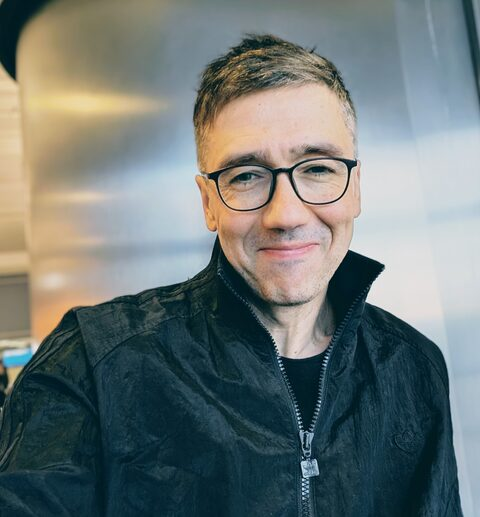

  <figure>
    
    <figcaption>Author photo: <a href="/public/denten-profile-cl.jpeg" download>color</a> · <a href="/public/denten-profile-bw.jpeg" download>black &amp; white</a></figcaption>
  </figure>
  

    
Professor of English and Comparative Literature, Columbia University

    <ul class="links">
      <li><a href="https://github.com/denten/denten.github.io/raw/master/_includes/CV/imprints/denten-CV.pdf">CV (PDF)</a></li>
      <li><a href="http://english.columbia.edu/people/profile/453">Department</a></li>
      <li><a href="https://nil.columbia.edu/">Lab</a></li>
      <li><a href="https://orcid.org/0009-0008-7162-8459">ORCID</a></li>
    </ul>
  

## Short Bio (53 words):

> Dennis Yi Tenen is a Professor of English and Comparative Literature at Columbia
> University, where he directs the [Narrative Intelligence Lab][12]. He studies how stories are
> written and shared, by people and by machines. His recent work includes [*Literary Theory for
> Robots*][11] (Norton, 2024) and "The Standardization of Fast Fiction" (*Computational Humanities
> Research*).

## Longer Bio (141 words):

> Dennis Yi Tenen is a Professor of English and Comparative Literature at Columbia University,
> where he directs the [Narrative Intelligence Lab][12]. He studies how stories are written and
> shared, by people and by machines. His [recent work][22] includes [*Literary Theory for
> Robots*][11] (Norton, 2024), "The Standardization of Fast Fiction" (*Computational Humanities
> Research*), "Anatomy of Vaccine Hesitancy: Folk Skepticism as Worldview in the Language and
> Rhetoric of Online Communities" (*Narrative*), and "Distributed Agency in the Novel" and "Toward
> a Computational Archaeology of Fictional Space" (both *New Literary History*).
>
> He is also the author of [*Plain Text: The Poetics of Computation*][3] (Stanford, 2017);
> *Author Function* is under review with the University of Chicago Press. A long-time affiliate of
> Columbia's Data Science Institute, he was formerly a Microsoft engineer in the Windows group and
> a fellow at the Berkman Center for Internet and Society.

[1]: http://english.columbia.edu
[2]: http://datascience.columbia.edu/new-media
[3]: http://www.sup.org/books/title/?id=26821
[4]: http://xpmethod.plaintext.in
[5]: https://github.com/denten/denten.github.io/raw/master/_includes/CV/imprints/denten-CV.pdf
[6C]: https://github.com/denten/denten.github.io/blob/master/public/denten-profile-cl.jpeg
[6B]: https://github.com/denten/denten.github.io/blob/master/public/denten-profile-bw.jpeg
[7]: http://english.columbia.edu/people/profile/453
[9]: https://orcid.org/0009-0008-7162-8459
[11]: https://wwnorton.com/books/9780393882186
[12]: https://nil.columbia.edu/
[22]: https://academiccommons.columbia.edu/search?f%5Bauthor_ssim%5D%5B%5D=Tenen%2C+Dennis
